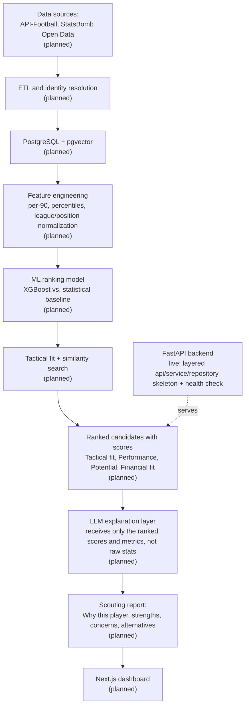

# football-scout

AI-powered football scouting and recruitment platform. A two-person Master's project combining match data, machine learning, tactical analysis, and LLM-based reasoning to identify and explain transfer targets.

The core idea: a statistical/ML model does the actual ranking of candidate players against a club's tactical needs, and an LLM only explains that ranking in scouting language, grounded in the model's own numbers. The LLM never invents a recommendation on its own, it narrates one that already came out of data and code.

## Current status

This repository is in its early implementation phase. What's real so far:

- [x] Monorepo structure for frontend, backend, ml, data, scripts, docs
- [x] FastAPI backend skeleton with a layered architecture (`api` → `services` → `repositories`) and a working `GET /api/v1/health` endpoint, covered by a pytest test
- [ ] PostgreSQL + pgvector, Redis, Celery workers (not yet wired up)
- [ ] Data ingestion from API-Football and StatsBomb
- [ ] Feature engineering, per-90/percentile normalization, position-specific scoring
- [ ] ML ranking model and baseline comparison
- [ ] LLM explanation layer and natural-language query parsing
- [ ] Next.js frontend

The sections below describe the designed system, drawn directly from the project's architecture document ([PROJECT_GUIDE.md](./PROJECT_GUIDE.md)), with each piece labeled as built or planned so the scope is clear rather than overstated.

## The pipeline (designed architecture)



Why the LLM sits after the ML step, not before it: the project's architecture principle (section 25/54 of the guide) is explicitly that the LLM is never the ranking engine. Football data flows through deterministic statistics and an ML model first; the LLM only receives the already-ranked, already-scored output and turns it into prose. This avoids a model confidently inventing "Player X is the best fit" with no retrievable evidence behind it, which is the usual failure mode of LLM-wrapper scouting tools.

## What's technically interesting (by design)

- **Grounded explanations, not freeform generation.** The LLM's prompt is meant to be built from structured scoring output (tactical fit, performance, potential, financial fit, plus the specific percentile stats behind each) rather than raw player tables, so it has concrete numbers to cite instead of stats to hallucinate.
- **Position-specific scoring, not one formula for everyone.** A center-back and a winger are planned to be scored on different feature sets (aerials/interceptions vs. progressive carries/xA), with weights determined experimentally rather than asserted.
- **Explicit ML task definition.** The guide requires picking one concrete, measurable ML research question (e.g. tactical-fit classification vs. future-performance prediction) rather than vague "AI-powered" claims, and evaluating it against simple baselines (goals/90, weighted statistical score) with real metrics (Precision@K, NDCG@10).
- **Leakage-aware evaluation plan.** Train/validation/test splits are designed temporally (e.g. train on 2019-2022, test on 2024) to simulate what the model could have known at recommendation time, not retrospectively.
- **Multi-source identity resolution.** Players from API-Football and StatsBomb don't share IDs; the schema plans an internal `player_id` with a `player_external_ids` mapping table rather than assuming sources are interchangeable.

## Features

Built:

- FastAPI backend with versioned API (`/api/v1`), layered separation of API/service/repository/ML/AI concerns, and a tested health-check endpoint
- Pydantic-settings based config loaded from `.env` (database, Redis, API-Football, LLM, and embedding keys, JWT secret)
- Pytest test suite with `TestClient`

Planned (scoped and designed, not yet built):

- Natural-language scouting queries ("find me a U23 defensive midfielder under 15M who fits a high-pressing 4-3-3") parsed into a validated structured filter, never trusting raw LLM output for the final query
- ML-ranked candidate lists with an explicit Scout Score (tactical fit, performance, potential, financial fit)
- Player similarity search via pgvector embeddings
- LLM-generated scouting reports with cited strengths/concerns and tool-calling access to `get_player_profile`, `get_tactical_fit`, `get_similar_players`, etc.
- Next.js dashboard for player profiles, comparisons, and AI reports

## Tech stack

| Layer | Tools |
| --- | --- |
| Backend | Python, FastAPI, Pydantic, Pydantic-Settings, SQLAlchemy, Alembic |
| Database (planned) | PostgreSQL, pgvector |
| Data/ML (planned) | Pandas, NumPy, scikit-learn, XGBoost |
| AI (planned) | LLM API (provider abstracted behind an internal AI service), embedding model |
| Background processing (planned) | Redis, Celery |
| Frontend (planned) | Next.js, TypeScript, Tailwind CSS, shadcn/ui, TanStack Query, Recharts |
| Testing | Pytest, FastAPI TestClient |
| Infra | Docker, Docker Compose, GitHub Actions |

## Running it locally

Right now there's only the backend skeleton to run:

```bash
cd backend
python3.12 -m venv .venv
source .venv/bin/activate
pip install -r requirements.txt

uvicorn app.main:app --reload
# -> http://127.0.0.1:8000/api/v1/health
# -> http://127.0.0.1:8000/docs
```

Run tests:

```bash
pytest tests/
```

There is no ML model, LLM integration, dataset, notebook, or frontend checked into the repo yet, so there's no end-to-end demo or saved example output to show at this stage. The full design, including the data sources (API-Football, StatsBomb Open Data, optional SkillCorner), database schema, ML evaluation methodology, and phased build order, is documented in [PROJECT_GUIDE.md](./PROJECT_GUIDE.md).

## Repository layout

- `frontend/` - Next.js app (scaffolded, empty)
- `backend/` - FastAPI app (API, services, repositories, scout engine, ML, AI)
- `data/` - raw / processed / external datasets (not committed)
- `ml/` - notebooks, experiments, training, evaluation, trained models (scaffolded, empty)
- `scripts/` - ingestion, processing, and database scripts (scaffolded, empty)
- `docs/` - architecture, API, ML, data, and research documentation (scaffolded, empty)
- `docker/` - Docker-related config (scaffolded, empty)
